# Workavera iOS

The native iPhone and iPad client for [Workavera](https://github.com/xusenlin/workavera),
a self-hosted AI workspace. Its modules and interaction patterns follow the
Workavera web app: Dashboard, Reading, Contacts, Chat, Board, Docs, Calendar,
Notifications, and Settings, plus an Agenda home screen widget.

## Screenshots

### iPhone

| Dashboard | Board | Calendar | Reading |
| :---: | :---: | :---: | :---: |
| 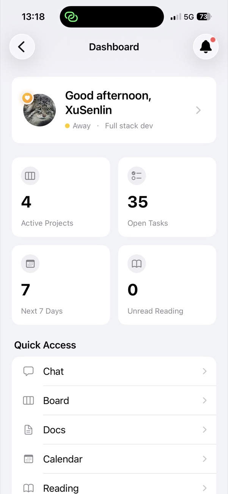 | 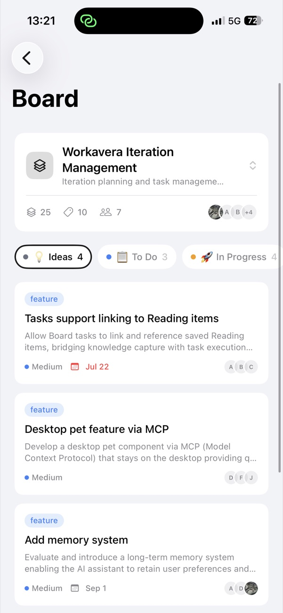 | 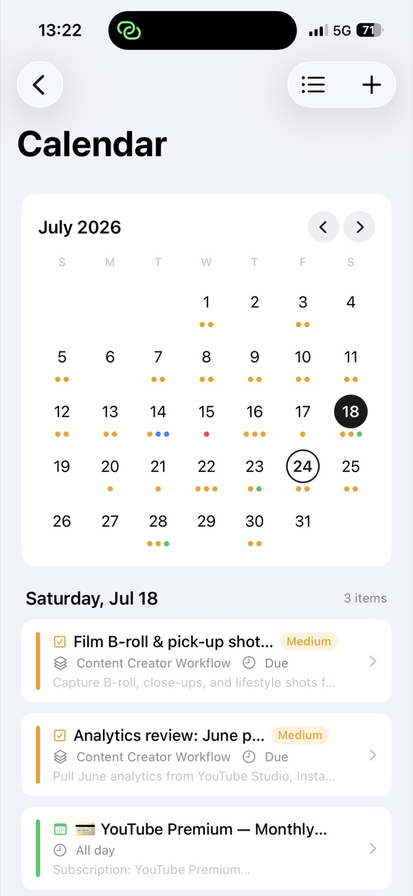 | 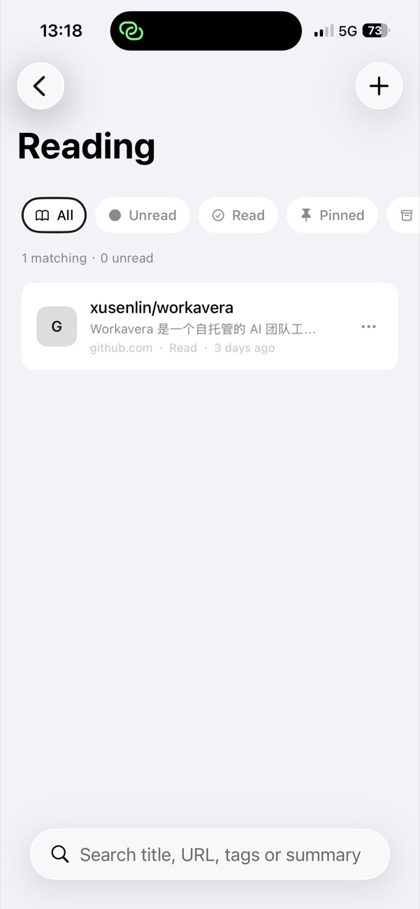 |

| Chat: creating Calendar events | Chat: setting up a project | Contacts | Settings |
| :---: | :---: | :---: | :---: |
| 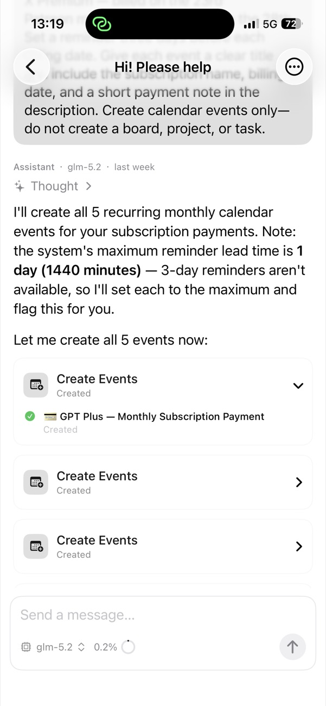 | 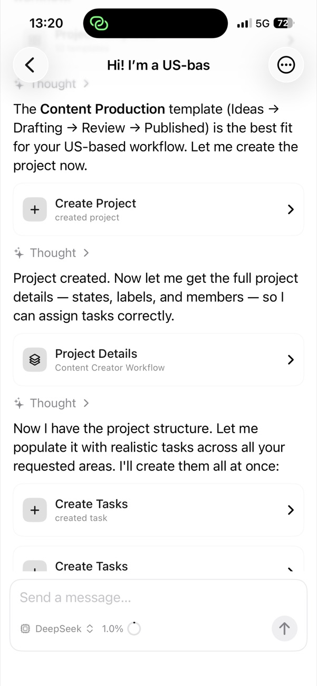 | 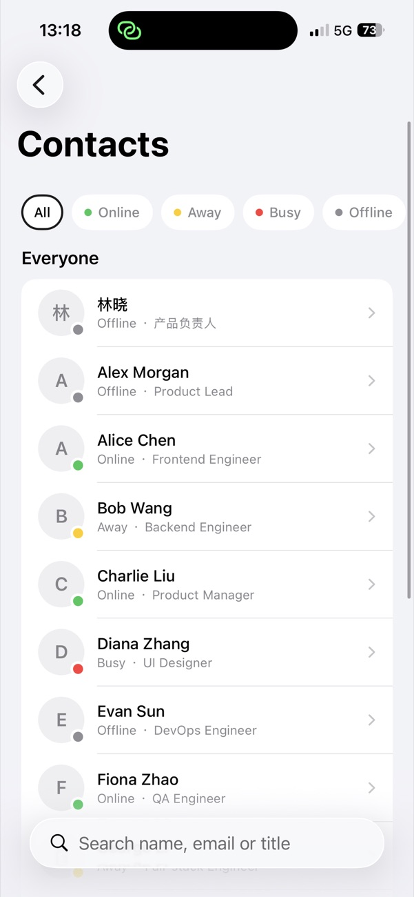 | 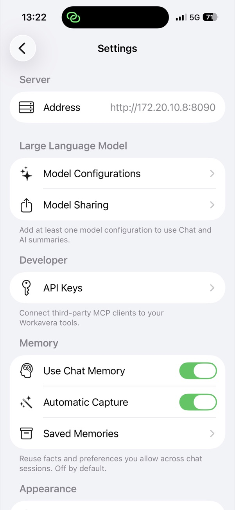 |

### iPad

| Board | Chat |
| :---: | :---: |
| 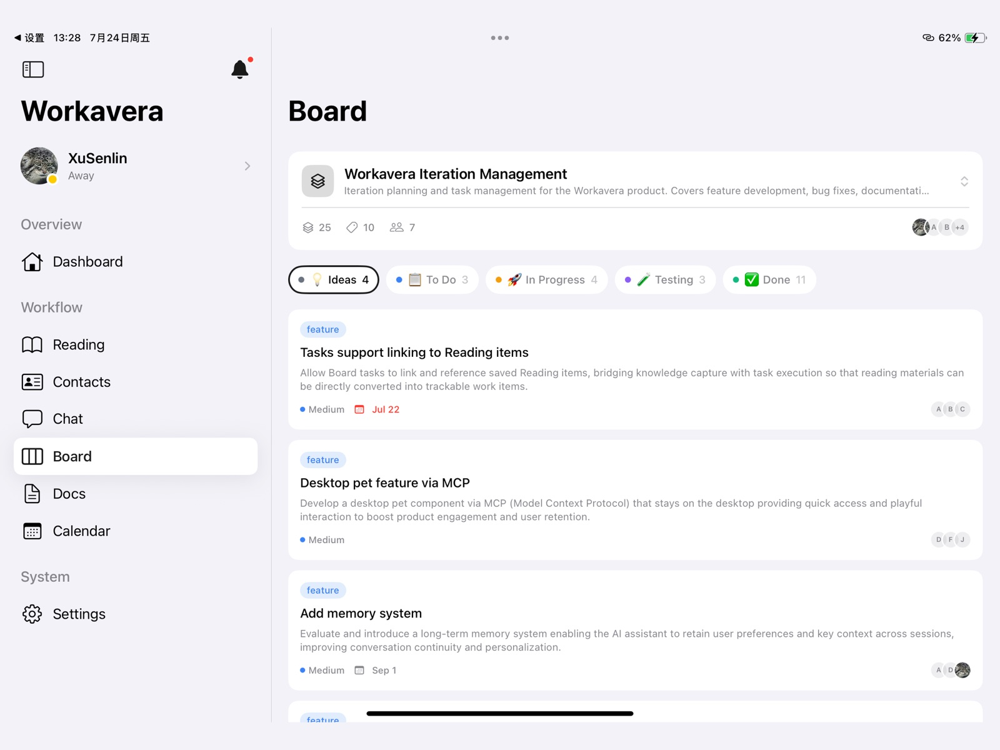 | 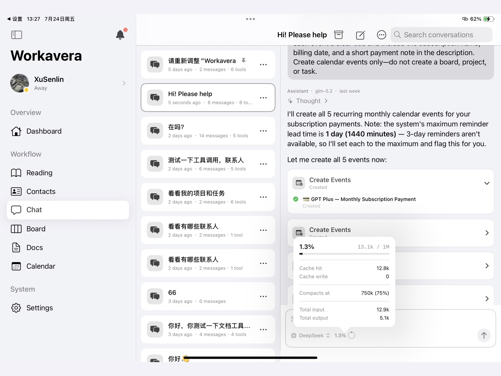 |

| Docs | Calendar |
| :---: | :---: |
| 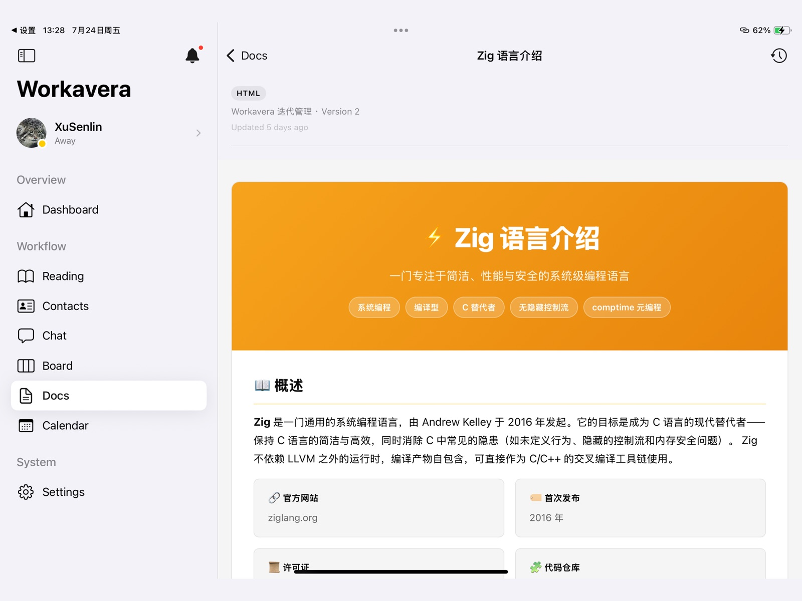 | 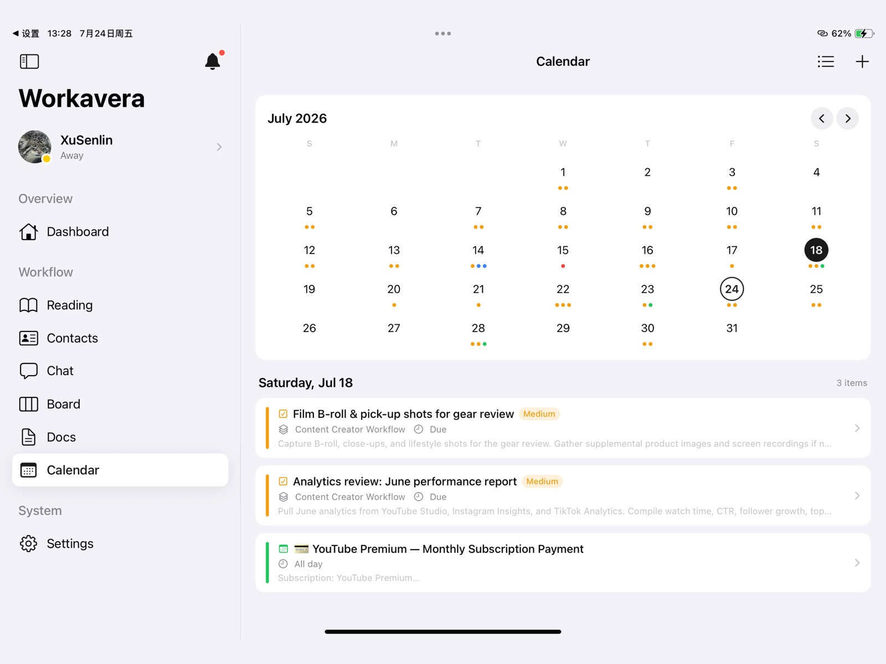 |

| Dashboard | Notifications |
| :---: | :---: |
| 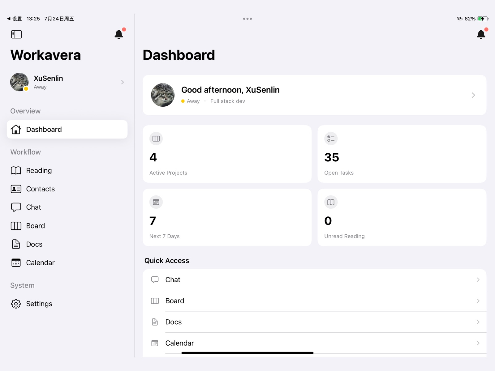 | 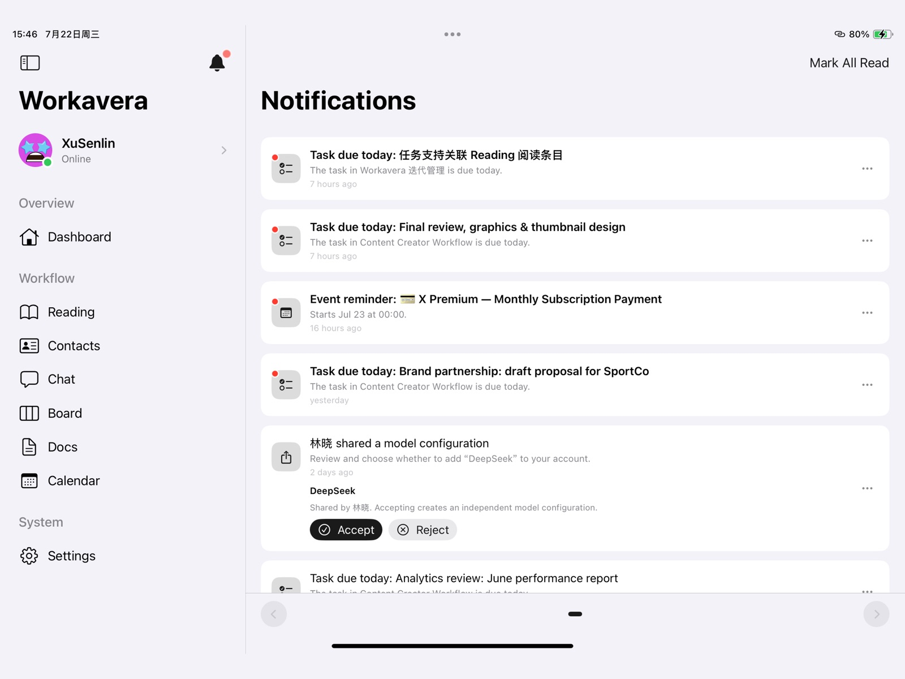 |

## Server Requirement

**This version needs a Workavera server on 0.1.1 or newer**, because task start
dates, public project links, and subscription discovery depend on fields and
endpoints added in that release. Upgrade the server first. The
[server README](https://github.com/xusenlin/workavera#server-compatibility)
carries the full version table.

The app does not provide account registration or automatic account creation.
Sign-in accounts are provisioned and managed by the administrator of each
self-hosted Workavera server.

## Features

- **Dashboard** — a greeting with your status, counts of active projects, open
  tasks, the next seven days' events, and unread reading, plus quick access to
  every module.
- **Board** — Kanban projects with workflow states, labels, members,
  priorities, and start and due dates. Archive and restore tasks, and publish a
  project to a public preview link.
- **Docs** — folders, rendered documents, and version history. Publish a
  document to a public link that stays pinned to the revision you choose.
- **Calendar** — a month view with your events merged with assigned Board
  deadlines and reminders.
- **Reading** — a reading list with tags, read status, pinning, and AI
  summaries. Discover pulls new candidates from your RSS/Atom feeds or GitHub
  trending subscriptions.
- **Contacts** — search teammates and collaborators by name, email, or title,
  with online status.
- **Chat** — streaming conversations with the Workavera assistant, which can
  search and act on your Board, Calendar, Docs, Contacts, Reading list, and
  memories. Tool calls render as readable result cards, and actions that need
  approval can be accepted or rejected in place.
- **Notifications** — task due alerts, calendar reminders, and model share
  requests, each with a detail sheet.
- **Settings** — theme, model configurations and sharing, MCP servers, API
  keys, chat memory and saved memories, server information, and optional
  tips through StoreKit.
- **Profile** — edit your name, title, and bio, crop and upload a square
  avatar, set your status, and change your password.
- **Agenda widget** — a medium or large home screen widget listing your next
  six or eight task deadlines and Calendar events, with a refresh button, a
  Chat shortcut, and a choice of tasks, events, or both.

## Technology

- **SwiftUI** and the **Observation** framework (`@Observable` / `@Environment`, iOS 17+)
- **async/await** and `URLSession` for direct access to the PocketBase HTTP API
- **NavigationSplitView** with an iPad sidebar and automatic compact navigation on iPhone
- Cached API responses shown first and then revalidated against the server, plus shared memory and disk caching for raster and SVG avatars
- Server-scoped authentication tokens stored in the **Keychain**, with server settings in `UserDefaults`
- HTTPS required by default; loopback HTTP is allowed, while LAN HTTP requires explicit risk acknowledgement
- **WidgetKit** and **App Intents** for the Agenda widget, sharing the session through an App Group
- XCTest coverage for server validation, network error parsing, chat tool payloads, preferences, caching, the widget snapshot, and session recovery
- Xcode 16 project format with file-system-synchronized groups, so new source files do not require project-file edits

## Project Structure

```
Workavera/
├── WorkaveraApp.swift           # Entry point: session recovery → login or main interface
├── AppLinks.swift               # Privacy policy, support, and repository URLs
├── Models/                      # Server records and chat tool payloads for each module
├── Services/
│   ├── PocketBaseClient.swift   # Typed networking, profiles, uploads, and user preferences
│   ├── APIResponseCache.swift   # On-disk cache of API responses
│   ├── CachedPageLoader.swift   # Show cached content first, then revalidate
│   ├── ServerConfiguration.swift # HTTPS/HTTP policy and address normalization
│   └── Keychain.swift           # Server-scoped secure token storage
├── Stores/                      # One observable store per module (Auth, Board, Chat, Docs, …)
├── Components/                  # Shared avatars, Markdown, filters, search, pagination, and banners
├── Widget/                      # Agenda snapshot and App Group storage shared with the widget
└── Views/
    ├── AppSection.swift         # App sections, menu labels, icons, and descriptions
    ├── RootView.swift           # Adaptive sidebar and detail navigation
    ├── LoginView.swift          # Authentication and server selection
    ├── DashboardView.swift      # Greeting, summary statistics, and quick access
    ├── BoardView.swift          # Projects, tasks, archiving, and project sharing
    ├── DocsView.swift           # Folders, documents, history, and publishing
    ├── CalendarView.swift       # Month view, events, and Board deadlines
    ├── ReadingView.swift        # Reading list; ReadingDiscoverView.swift adds Discover
    ├── ContactsView.swift       # Teammate search
    ├── ChatView.swift           # Adaptive iPhone/iPad chat and tool-result interface
    ├── NotificationsView.swift  # Notification list and detail sheet
    ├── ProfileView.swift        # Profile editing, avatar cropping, password, and status
    ├── SettingsView.swift       # Preferences, server information, tips, and account actions
    └── …                        # Model, MCP server, API key, and memory settings screens
WorkaveraWidget/                 # Agenda widget extension: next six or eight items with dates, refresh button
WorkaveraTests/                  # XCTest suites
StoreKit/                        # Local StoreKit configuration for testing tips
```

The app and the widget share the `group.com.xusenlin.workavera.ios` App Group.
The app writes the signed-in server, user, and token there (the token in the
App Group keychain access group) so the widget can fetch the agenda on its own.

## Running

1. Start a local Workavera backend (default: `http://127.0.0.1:8090`):

   ```bash
   cd ~/Git/Github/workavera && ./workavera serve
   ```

2. Open `Workavera.xcodeproj` in Xcode 16 or later, choose an iOS 17+ simulator, and run the `Workavera` scheme.

3. A fresh installation connects to `https://demo.workavera.com`. To use your own Workavera deployment, open **Server Settings** from the login screen before signing in. The iOS Simulator can reach a backend on the Mac through `127.0.0.1`. For a physical device, prefer HTTPS. To temporarily use a Mac over LAN HTTP, start the backend with `--http=0.0.0.0:8090` and explicitly enable insecure HTTP in Server Settings.

After signing in, the sidebar, Dashboard, and Profile display the user's avatar, name, title, bio, and online status from the server. Settings persists theme and memory preferences through `user_preferences` and provides local sign-out. Account lifecycle management is handled by the selected server's administrator.

## Testing

Run the `Workavera` scheme tests in Xcode, or use:

```bash
xcodebuild test \
  -project Workavera.xcodeproj \
  -scheme Workavera \
  -destination 'platform=iOS Simulator,name=iPhone 17'
```
